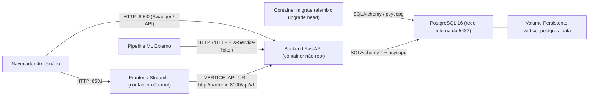
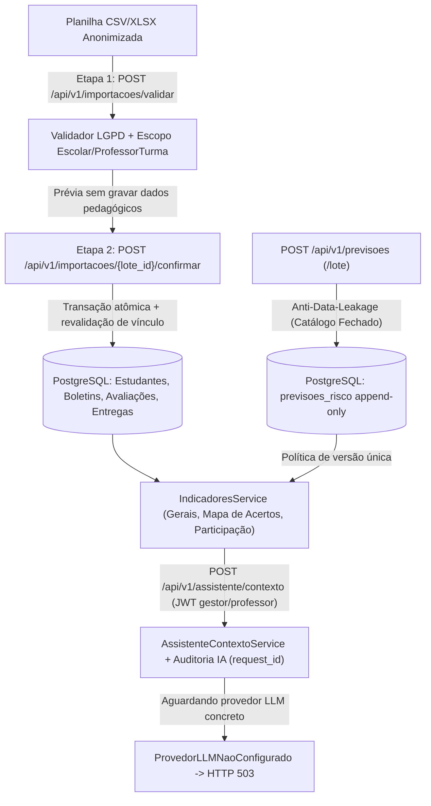

# Arquitetura, Evolução Histórica e Compatibilidade — Projeto Vértice

Este documento registra a arquitetura atual implementada no repositório, a hierarquia técnica entre documentação e código, as decisões de compatibilidade em relação aos documentos acadêmicos conceituais iniciais presentes em `docs/` e as regras invariantes do sistema.

---

## 1. Hierarquia de Autoridade Técnica (Fonte de Verdade)

Sempre que houver aparente divergência entre artefatos durante manutenção, suporte ou evolução do sistema, prevalece estritamente a ordem abaixo:

1. **Código-fonte executável** (`backend/app/**` e `Frontend vertice/**`)
2. **Migrações Alembic e modelos ORM SQLAlchemy** (`backend/alembic/versions/**` e `models.py`)
3. **Contratos Pydantic e esquema OpenAPI gerado** (`schemas.py` e `/api/v1/openapi.json`)
4. **Suíte de testes automatizados** (`backend/tests/**`, incluindo integração real PostgreSQL e paridade OpenAPI)
5. **Documentação técnica Markdown** (`README.md`, `backend/README.md`, `backend/docs/*.md`, `docs/*.md`)
6. **PDFs conceituais originais de planejamento** (`docs/*.pdf` — preservados integralmente como referência histórica)

---

## 2. Evolução Histórica e Divergências em Relação aos PDFs Originais

Os documentos PDF preservados em `docs/` refletem a concepção inicial do projeto acadêmico. Durante a implementação incremental até a Fase 8, diversas evoluções técnicas de segurança, governança LGPD e rigor analítico foram consolidadas no código **sem perder compatibilidade conceitual**:

| Domínio | Concepção Inicial (PDFs originais) | Estado Consolidado no Sistema (Fases 2–8) | Regra de Compatibilidade |
| :--- | :--- | :--- | :--- |
| **Perfis de Acesso (RBAC)** | Rascunhos conceituais citavam perfis como *Administrador*, *Coordenador* e *Professor* | O enum oficial `PapelUsuario` implementa exclusivamente **`administrador`**, **`gestor`** e **`professor`**. O papel `gestor` absorve integralmente as atribuições de direção/coordenação escolar com escopo obrigatório em `escola_id` | **Não criar** papel `coordenador` separado; toda documentação e código referenciam apenas os 3 papéis canônicos |
| **Estudantes e LGPD** | Fluxos simples de listagem escolar e referências pontuais a dados discentes | Anonimização estrita: estudantes possuem apenas `id` (UUID) e `codigo_anonimo`. Não há CRUD manual de estudante nem dados nominais (LGPD). O validador inspeciona cabeçalhos e células contra CPF, e-mail, telefone e padrões nominais | Nenhuma coluna nominal/PII pode ser persistida ou retornada pela API |
| **Planilhas de Importação** | Versão preliminar previa carga simples de avaliações com coluna binária `Acertou` (6 colunas) | Adotou-se importação transacional em **2 etapas (`validar` -> `confirmar`)** com detecção e geração de 3 modelos: **Dados Escolares (14 colunas)**, **Avaliações (16 colunas)** e **Atividades (12 colunas)**. Avaliações exigem `alternativa_marcada` (`A`-`E` ou `BRANCO`) e bloqueiam planilhas legadas apenas com `Acertou` | O backend gera modelos oficiais atualizados em `/api/v1/importacoes/modelos/*`; planilhas obsoletas recebem orientação clara na prévia |
| **Escopo do Módulo `participacao`** | Descrição ampla que por vezes associava participação diretamente à frequência de aulas | **`participacao` controla Atividades e Entregas** (`Atividade`, `EntregaAtividade`: no prazo, atrasado, pendente, não entregue — calculando sobre quem *deveria* entregar). Frequência percentual e faltas ficam no boletim periódico (`BoletimPeriodo`) via `DADOS_ESCOLARES` | Não duplicar controle de frequência escolar dentro de `participacao` |
| **Predição de Risco e Assistente IA** | Previsão de integração futura com ML e assistente sem contrato formal | Contrato completo: credenciais técnicas `vtx_ml_*` (hash SHA-256) via `X-Service-Token`, tabela append-only `previsoes_risco`, anti-data-leakage fechado (`CATALOGO_VARIAVEIS_PREDITIVAS`, rejeição de desconhecidas `HTTP 422`), `situacao_final` reservada como alvo supervisionado, auditoria IA (`request_id`) e interface `ProvedorLLMBase` retornando `503` até plugar LLM | Nunca aceitar JWT de usuário comum na ingestão preditiva nem variáveis sem contrato; nunca simular respostas de IA |
| **Frontend Web (Streamlit)** | Protótipo inicial alimentado por dados locais simulados (`mock_data.py`) | Todas as telas ativas consomem exclusivamente a API FastAPI via `Frontend vertice/data/api_client.py` (sem login offline nem dados fictícios) | `mock_data.py` permanece com estruturas vazias apenas para não quebrar teste regressivo legado da Fase 5, e é bloqueado nas telas ativas pelo CI |

---

## 3. Matriz Canônica de Papéis, Permissões e Isolamento

### 3.1 Papéis de Usuários Humanos (Autenticação JWT Bearer)

| Capacidade / Rota Principal | `administrador` | `gestor` | `professor` |
| :--- | :--- | :--- | :--- |
| **Criar / Editar Usuários** (`/api/v1/usuarios`) | Rede inteira | Apenas consulta usuários da sua `escola_id` e professores sem escola fixa (`GET`) | Bloqueado (`403`) |
| **Emitir / Revogar Credenciais ML** (`/api/v1/previsoes/credenciais`) | Rede inteira | Bloqueado (`403`) | Bloqueado (`403`) |
| **Escolas, Turmas, Disciplinas e Atribuições** | Rede inteira | Restrito à sua `escola_id` (exige `escola_id` vinculada; consulta/cria na própria escola) | Somente leitura do próprio escopo (`GET`; escrita retorna `403`) |
| **Importação em 2 Etapas e Modelos** (`/api/v1/importacoes/*`) | Bloqueado (`403` — segregação de funções) | Permitido exclusivamente para turmas da sua `escola_id` | Permitido exclusivamente para `(turma_id, disciplina_id)` ativos em `professor_turmas` |
| **Estudantes Anonimizados e Boletins** (`/api/v1/estudantes/*`) | Bloqueado (`403`) | Todos os estudantes da sua `escola_id` | Apenas estudantes das suas turmas e disciplinas vinculadas (ou turma inteira se `disciplina_id = NULL`) |
| **Avaliações, Atividades, Acompanhamentos e Indicadores** | Bloqueado (`403`) | Escopo completo da sua `escola_id` | Escopo estrito de `professor_turmas` (`turma` + `disciplina` ou regência polivalente) |
| **Contexto IA (`POST /api/v1/assistente/contexto`)** | Bloqueado (`403` e auditado como `NEGADO`) | Escopo da sua `escola_id` | Escopo restrito às suas turmas/disciplinas |
| **Auditoria de Consultas IA (`GET /api/v1/assistente/auditoria`)** | Todas as escolas (metadados sem PII) | Somente eventos da sua `escola_id` | Somente suas próprias execuções |

### 3.2 Credenciais Técnicas de Pipeline ML (`X-Service-Token`)
- Autenticação exclusiva para `POST /api/v1/previsoes` e `POST /api/v1/previsoes/lote`.
- O segredo bruto (`vtx_ml_*`) nunca é armazenado em texto claro no banco (apenas prefixo + hash SHA-256).
- Pode ser escopada por `escola_id` e lista `modelos_permitidos`. Tokens JWT de usuários humanos recebem `403`.

---

## 4. Diagramas de Fluxo e Arquitetura Atual

### 4.1 Topologia de Execução e Isolamento de Rede (Docker Compose)

### 4.2 Fluxo de Entrada de Dados, Indicadores e Contexto IA Seguro

---

## 5. Regras de Ouro (O que Não Pode Ser Quebrado)

1. **Isolamento Multi-Escola e de Vínculo Docente:** nunca confiar em colunas `escola_id` ou `professor_id` enviadas por planilhas nem relaxar o filtro de `disciplina_id` em listagens ou cálculos de professores.
2. **Unidocência (`disciplina_id IS NULL`):** preservar o índice único parcial em PostgreSQL (`uq_professor_turma_polivalente`) impedindo atribuições polivalentes duplicadas na mesma turma.
3. **Importação em Duas Etapas + Preservação Longitudinal:** nunca inserir estudantes diretamente fora da etapa confirmada de `DADOS_ESCOLARES`; preservar períodos passados em `boletins_periodo`, não substituir `situacao_final` consolidada por `NULL` e não sobrescrever gabaritos de questões que já possuem respostas (`HTTP 409`).
4. **Elegibilidade e Prazos em `participacao`:** entregas esperadas devem continuar considerando apenas estudantes ativos elegíveis no `ano_letivo`/`periodo_letivo` da atividade; após registros de participação, `periodo_letivo` da atividade não pode ser alterado (`HTTP 422`); ausências de nota nunca viram `0`.
5. **Prevenção de Data Leakage e Segregação ML:** manter `exige_contrato_para_desconhecidas = True`, `situacao_final` bloqueada como feature de entrada e rejeição imediata de chaves desconhecidas ou com PII/tokens em `variaveis_utilizadas` e `metadados_tecnicos`.
6. **Transparência do Assistente IA:** jamais inventar métricas ou simular respostas generativas quando nenhum provedor LLM estiver configurado (`503`), e manter a gravação de auditoria inclusive em cenários negados (`NEGADO`) ou de falha (`ERRO_EXECUCAO`).
7. **Paridade Contínua OpenAPI x Documentação:** qualquer nova rota no backend deve ser refletida em `backend/docs/API_ENDPOINTS.md` e validada por `backend/tests/test_api_docs_parity.py`.
